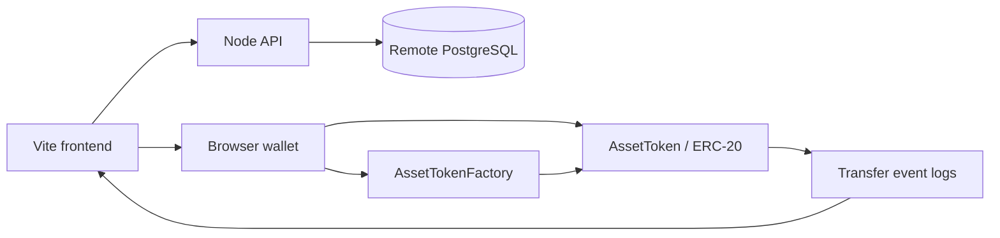

# Checkpoint 2 presentation and demo

Aim for 8–10 minutes. Rehearse with a fresh demo asset before presenting. The
implementation is Vite + ethers, a Node API, remote PostgreSQL, and Solidity
contracts using OpenZeppelin ERC-20. Do not describe the frontend as Next.js.

## Opening explanation (30–45 seconds)

Say:

> Checkpoint 1 created a fixed-supply token for an asset. For Checkpoint 2, I added
> interactions between multiple wallets, security tests, transaction history,
> PostgreSQL asset records, and metadata integrity verification. Token ownership
> is recorded on the blockchain. Descriptions and business metadata are stored
> in PostgreSQL. An on-chain hash lets the application detect changes to that
> off-chain information.

Show this architecture:



Say that signed transactions go through the browser wallet. The API retrieves
database data and never needs a wallet private key. The database record's token
address and chain ID connect the two sources of information.

## Prepare before the presentation

1. Have Alice, Bob, and Carol browser accounts ready on Sepolia, with enough test
   ETH for the sending accounts. Record their actual addresses for copy/paste.
2. Have your factory address ready. Use the same factory and chain throughout.
3. Confirm the API's ignored `server/.env` uses the remote asset database, port
   5432, and the working `asset_token_app` credentials.
4. From `server`, run `npm run check-db`, then `npm run dev`.
5. In another terminal, from `frontend`, run `npm run dev` and open Vite's URL.
6. Upload the current `database` folder from this repo to `/root/database` on the
   server if you previously uploaded only the standalone setup script:

   ```powershell
   scp -r database root@167.233.214.178:/root/
   ```

7. Keep a separate SSH terminal open for the import and tamper demonstration.
   Keep passwords and `.env` files out of the shared presentation screen.
8. Run the test suite once and save its successful output as backup evidence.

If an asset ID has already been tokenized by your factory, use a new ID and update
the demo commands accordingly. Existing tokens cannot have their hash replaced
through this contract. An old zero hash shows as unanchored; an older unrelated
document format may fail this format's check.

## Create the committed demo asset (about 90 seconds)

Connect Alice and use these values:

| Field | Value |
|---|---|
| Asset ID | `coffee-cp2-001` |
| Asset name | Duong Coffee |
| Asset type | Business |
| Valuation | `500000` |
| Currency | USD |
| Metadata URI | `urn:asset:coffee-cp2-001` |
| Token name | Duong Coffee Token |
| Token symbol | DCOF |
| Initial supply | `100000` |
| Description | Coffee shop |
| Additional metadata | `{"location":"Indianapolis","documents":["business-info.json"]}` |

The URI is an identifier for this demo. The app does not fetch a document from it.
The metadata fields themselves are stored in PostgreSQL after import.

Show the automatically calculated hash, then create the token and approve the
wallet transaction. Show Alice's 100,000 balance, the token address, the creation
transaction hash, and the initial mint event. Show the matching hash in the
metadata integrity section; at this stage it is checking the current draft.

Say:

> The constructor mints the supply to the issuer once. The frontend computes a
> Keccak-256 hash of a consistent JSON document before tokenization and sends
> that hash to the constructor. The full description stays off chain.

Immediately press **Download asset record** so the original description/metadata
are preserved before switching accounts. Rename the download to `asset.json`, then
upload it from your PC:

```powershell
scp "PATH_TO_DOWNLOADED_ASSET.json" root@167.233.214.178:/root/database/asset.json
```

On the remote server, import it:

```bash
bash /root/database/import-asset.sh /root/database/asset.json
```

This runs using the container's PostgreSQL admin account. The API account only
needs read permissions. You can prepare the import before the talk and show its
result rather than spending presentation time on the upload.

## Demonstrate transfers and history (about 2 minutes)

1. Alice transfers `10000` to Bob. Wait for confirmation. Show Alice's refreshed
   balance of 90,000 and the transfer's event row and transaction hash.
2. Switch to Bob, reconnect, and load `coffee-cp2-001`. Bob shows 10,000. Transfer
   `2500` to Carol. Bob shows 7,500.
3. Switch to Carol, reconnect, and load the same asset. Carol shows 2,500.

| Stage | Alice | Bob | Carol | Total supply |
|---|---:|---:|---:|---:|
| Created | 100,000 | 0 | 0 | 100,000 |
| Alice → Bob | 90,000 | 10,000 | 0 | 100,000 |
| Bob → Carol | 90,000 | 7,500 | 2,500 | 100,000 |

Say:

> Transfers move existing tokens, so supply remains unchanged. The application
> waits for confirmation and reads balances again. History comes from ERC-20
> Transfer events, including the mint from the zero address; I do not duplicate
> transaction history in Solidity storage.

For an older token, use **Load older blocks** until the creation and transfer
events are visible. History initially loads the newest 1,000-block window.

## Explain rejection and authorization (about 1 minute)

From `frontend`, run:

```powershell
node --test --test-name-pattern="checkpoint step 3" test/contracts.test.js
```

Show the named passing cases:

- Bob's attempted transfer of 10,000 with a 7,500 balance reverts.
- Carol's `transferFrom` without Bob's allowance reverts.
- Bob's approval for 1,000 permits that amount and consumes the allowance.

Say:

> OpenZeppelin enforces balance and allowance checks. My tests assert the exact
> contract errors and verify that balances, supply, and allowance stay unchanged
> after rejection. Failed calls are simulations; the approved transfer is a
> confirmed transaction on the local test blockchain.

Be explicit that automated tests deploy fresh local contracts and use Hardhat
accounts. They test the same Solidity source; they do not reuse your live Sepolia
wallets or mutate this live demo. The optional approval test's final balances are
6,500 for Bob and 3,500 for Carol, in that independent local test.

## Show the PostgreSQL link (about 1 minute)

Click **Load saved asset** and show the saved description, metadata, and valuation
alongside the blockchain balances. Point out the URL:

```text
/assets/coffee-cp2-001?chainId=11155111
```

On the server, optionally show this read-only query:

```bash
docker exec soccer-field-booking-management-db-1 psql -U postgres -d asset_token -c "SELECT asset_id, chain_id, token_address, issuer_address, valuation FROM public.assets WHERE asset_id = 'coffee-cp2-001' AND chain_id = 11155111;"
```

Say:

> The API looks up the database record by asset ID and chain ID. The frontend
> follows its token address, checks its factory registration and creation details,
> and reads current blockchain state. The database supplies business metadata;
> it does not determine token balances.

## Show integrity failure and recovery (about 2 minutes)

First show **Verified against blockchain** for the saved PostgreSQL record.
Expand **Canonical document used for verification** to show the exact hash input.

In the SSH terminal, deliberately alter only this demo asset's database valuation:

```bash
docker exec soccer-field-booking-management-db-1 psql -U postgres -d asset_token -v ON_ERROR_STOP=1 -c "UPDATE public.assets SET valuation = 900000, updated_at = now() WHERE asset_id = 'coffee-cp2-001' AND chain_id = 11155111 AND valuation = 500000 RETURNING asset_id, valuation;"
```

Confirm that exactly the intended demo row was returned. Click **Recheck saved
metadata**. Show **Integrity check failed**, the unequal hashes, the saved
valuation of 900,000, and the unchanged on-chain valuation of 500,000.

Say:

> Changing the database did not change the contract. The app reconstructs the
> saved document, hashes it again, and compares it with the original hash read
> directly from the token. That reveals the change. Trusting only a second hash
> stored in the same database would not provide this independent comparison.

Restore this demo valuation on the server:

```bash
docker exec soccer-field-booking-management-db-1 psql -U postgres -d asset_token -v ON_ERROR_STOP=1 -c "UPDATE public.assets SET valuation = 500000, updated_at = now() WHERE asset_id = 'coffee-cp2-001' AND chain_id = 11155111 AND valuation = 900000 RETURNING asset_id, valuation;"
```

Recheck again and show **Verified against blockchain**. Timestamp changes do not
affect the hash because timestamps are outside the committed document.

As a shorter backup, edit the description and press **Preview edited metadata
integrity**. It reports that the unsaved draft differs, without changing the
database. Explain that this is a draft preview, not the saved-database tamper demo.

## Closing explanation and limits (30 seconds)

> This checkpoint demonstrates multiple token holders, enforced ERC-20 transfer
> rules, history from events, and an application that combines PostgreSQL data
> with blockchain ownership. The hash detects changes relative to the recorded
> document. It does not prove that the asset valuation or business claims are true.

Mention that supply is fixed, record saving currently uses JSON download/import,
and the API is read-only. There is no document upload, valuation oracle, or public
mint function. Do not present these as completed features.

## Evidence to keep ready

- Token address, network, initial supply, and creation transaction screenshot.
- Three wallet balances after the valid transfers.
- Transfer history with transaction hashes.
- Security test output.
- PostgreSQL record linked to the same token/chain.
- Matching hashes before tampering, mismatching hashes after, and restored match.

Run full checks from their respective folders:

```powershell
# frontend
npm test
npm run build
# server
npm test
npm run check-db
```

The read-only remote connection was verified during implementation, but the assets
table was empty at that check. The automated integrity test uses the HTTP API with
a test database adapter and a real Hardhat deployment. Your imported live record
and browser-wallet demonstration must be rehearsed before presenting.
